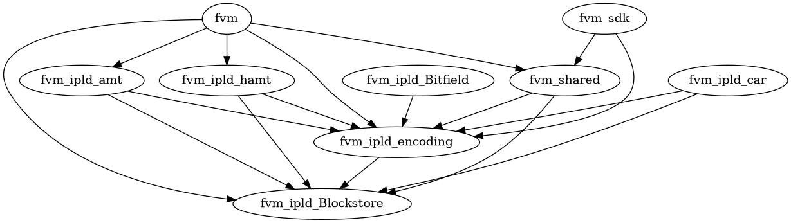

# Contributing

This document describes the process of contributing to the reference FVM implementation (this project).

## Issues

If you have a general FVM related question or idea, please either as on the [Filecoin Slack][chat], or open
a new discussion in [fvm-specs][discuss].

If you'd like to report a _bug_ or suggest an enhancement in the reference FVM implementation, please file [an issue][issue].

## Pull Requests

To make a change to the FVM.

1. When in doubt, open an [issue][] first to discuss the change.
2. Make your change.
3. Write a test for your change.
4. Update the crate's `CHANGELOG.md`. If you're making any breaking changes, prefix change with
   "BREAKING:".
5. Finally, open a PR.

## Releasing

Releases are cut from this branch (`release/v3`).

1. Make sure each crate's `CHANGELOG.md` is up-to-date (look through `git log -- path/to/crate`) and that conformance passes (`cargo test --package fvm_conformance_tests`).
2. Pick the next version for each crate you're releasing. Look through the changelogs and decide carefully whether it's a breaking release, then read [Rust's semver documentation](https://doc.rust-lang.org/cargo/reference/semver.html).
3. Use `cargo set-version` (from `cargo-edit`) to set each crate's version. This also updates the workspace's dependencies on it.
4. Set the release date and version in the changelogs, and add a new "Unreleased" section.
5. Open a PR against `release/v3`. The **Release Checker** action dry-runs the publish.

Once the release is prepared, it'll go through a review:

1. Make sure that we're _ready_ to release. E.g., make sure downstream can consume the release.
2. Make sure that we're correctly following semver.
3. Make sure that we're not missing anything in the changelogs.
4. Verify that the **Release Checker** action has passed, including the "Dry-run publish" step.

Finally, an [FVM "owner"](https://github.com/orgs/filecoin-project/teams/fvm-crate-owners/members) merges the release PR into `release/v3`. The **Releaser** action then tags each released crate (`crate_name@vX.Y.Z`), publishes the GitHub Release and publishes the crates to crates.io through trusted publishing.

### Crate Dependency Graph

The crates in this workspace have the following structure:

[chat]: https://docs.filecoin.io/about-filecoin/chat-and-discussion-forums/#chat
[discuss]: https://github.com/filecoin-project/fvm-specs/discussions
[issue]: https://github.com/filecoin-project/ref-fvm/issues
